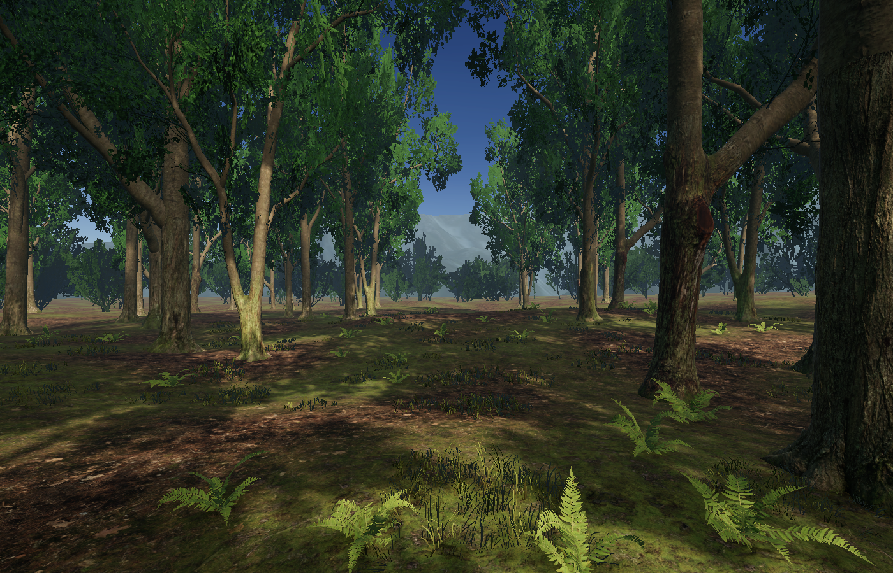

# Forest VR — Forest Sanctuary

A Unity forest clearing inspired by forest and alpine landscape photographs. The viewer stays in the middle of the clearing, surrounded by trees, moss, grass and ferns, with mountain views through the forest.

## Open the project

1. Clone this repository and open its root through Unity Hub using **Unity 6000.6.4f1**.
2. Let Unity restore the packages in `Packages/manifest.json` and `Packages/packages-lock.json`.
3. Import **Mountain Lake – Forest Pack by VIVID Arts, version 1.1.0**, from your Unity Asset Store account. Keep the original `Assets/VIVID_Arts` paths and `.meta` GUIDs. The source project already has this pack installed; a fresh clone needs its own import. The base meshes and textures from the initial pack import are sufficient for this scene: it supplies its own URP materials.
4. Open `Assets/ForestExperience/Scenes/Forest Sanctuary.unity`.
5. Press Play for desktop preview, or configure your target headset and build platform for VR testing.

The purchased asset pack is an external dependency and is **not redistributed in this public repository**. All authored scene data, terrain layout, scripts, shaders, materials, generated audio, Unity settings, and package manifests are included. Texture and mesh references require that pack. `Assets/ForestExperience/AssetDependencies.json` records the required pack assets and GUIDs.

## Experience

- Tall scanned trees and a distant forest layer surround the viewer.
- Moss and leaf-litter terrain, nearby grass and ferns, weathered rocks and alpine mountains.
- Natural daylight, shadows, atmospheric haze and gentle foliage wind.
- Quiet looping wind from the asset pack, with occasional synthesized birdsong.
- Head rotation and vertical headset movement stay active. Horizontal translation is constrained; no walking, teleporting, joystick locomotion or artificial turning.
- Floor tracking is requested. Runtimes without floor tracking use the configurable `ForestRig.fallbackEyeHeight` offset, initially 1.65 metres.
- 96 nearby vegetation touch surfaces. Grass/ferns bend away from contact, rustle, and trigger controller haptics where supported.
- Ground contact triggers soft rustling and small leaf-litter motes. The terrain stays solid.
- Controller tracking and optional OpenXR hand tracking; visible hands use simple glove proxies.

## Desktop controls

| Input | Action |
| --- | --- |
| Right mouse button + mouse movement | Look around |
| Page Up / Page Down | Raise or lower eye height |
| Left mouse button on nearby vegetation/ground | Simulate touch within 4 metres |

These preview controls are editor-only.

## VR testing

PC VR through **OpenXR** is the initial assumed target. For PC VR, use a Windows Unity installation with Windows build support, and select the headset's OpenXR runtime. No headset-specific executable is included.

OpenXR loader settings are also present for Android, but standalone Quest build settings and performance have **not** been validated. Select the appropriate device features, graphics APIs and build support for your hardware before building for Android. This forest has detailed foliage and may need further optimization on standalone hardware.

The project uses URP forward rendering, single-pass instanced stereo and 4x MSAA. GPU Resident Drawer is disabled for compatibility with the custom foliage shader and editor preview rendering.

Hardware stereo, actual floor calibration, hand-tracking availability, haptics, comfort and sustained frame rate require testing on the target headset. Development validation ran in the macOS editor with simulated XR input.

## Source layout

| Location | Contents |
| --- | --- |
| `Assets/ForestExperience/Scenes` | Saved forest scene |
| `Assets/ForestExperience/Scripts` | Stationary rig, controller/hand touch, ambience |
| `Assets/ForestExperience/Shaders` | Wind and touch-responsive foliage shader |
| `Assets/ForestExperience/Editor` | Scene builder, validation and simulated XR checks |
| `Assets/ForestExperience/Ground` | Authored terrain and terrain layers |
| `Assets/ForestExperience/Materials` | Scene materials referencing pack textures |
| `Assets/ForestExperience/Audio` | Generated birdsong and grass rustle |
| `Assets/XR` | OpenXR loaders and feature settings |
| `ForestReports` | Validation results and visual previews |

Unity menu **Forest Experience** provides scene rebuilding, preview rendering and reference validation. Rebuilding saves the current scene and recreates Forest Sanctuary deterministically; do not rebuild if you want to keep manual changes to its generated layout.

The editor-only `ForestBridge` also accepts local commands through `ForestReports/command.txt`: `inspect`, `build`, `preview`, `validate`, `smoke`, `touch`, `play`, `stop`, and `finalize`. `smoke` temporarily disables native XR startup for simulated editor testing, then restores it when returning to Edit mode. Use it without a connected real headset.

## Validation recorded

- Scene/reference checks passed for materials/shaders, terrain, audio, rig, touch surfaces and OpenXR loaders.
- Simulated headset heights of 1.65 m, 0.95 m and 0.22 m passed; horizontal movement stayed locked and head rotation was preserved.
- Simulated controller alignment, grass rustling, terrain-contact particles and looping wind passed.
- Rendered before/after touch images confirmed visible grass deformation.

See the reports in `ForestReports`. These checks do not replace testing on a headset.
